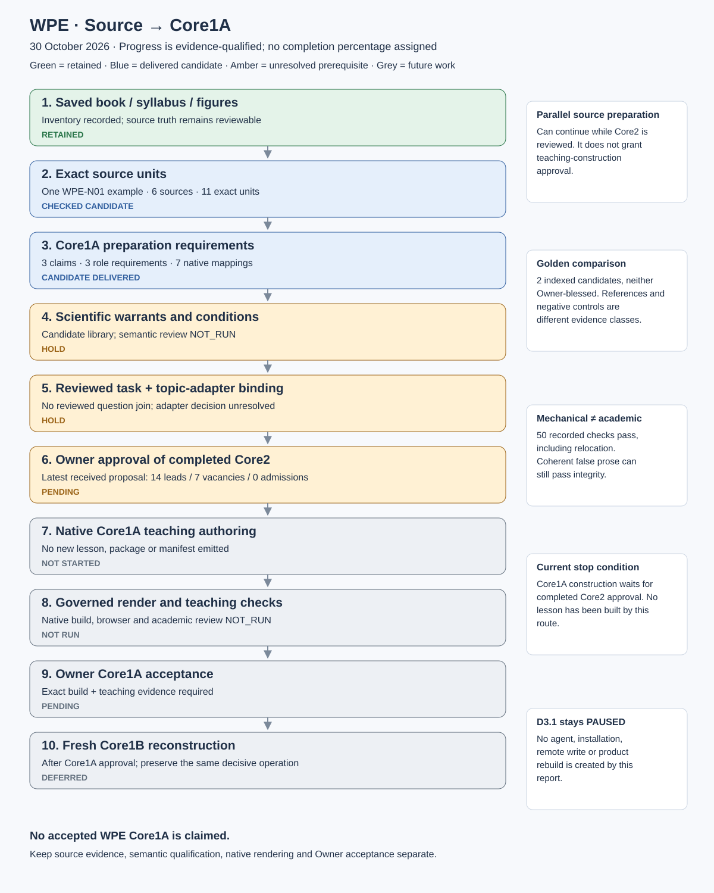

# WPE Source → Core1A — Progress and Technical Concept Report

**Date:** 30 October 2026 · Asia/Dubai.  
**Assessment:** **PARTIAL — one mechanically checked preparation example; no qualified or rendered Core1A lesson.**  
**Session:** Oracle (standalone), thread `01a188e5-af7a-7881-b414-b465ca99680f`.  
**Purpose:** document the actual Source → Core1A frontier, the golden comparison set, unresolved seams and the evidence needed to advance. This is a documentation result, not a new implementation, reviewer appointment, approval or learner release.

## A. Decision and progress diagram

Retain two coordinated routes. The non-bank route prepares the content and warrants; the question-bank route establishes the exact intellectual requirement. Neither alone establishes a complete teaching construction.



The blue candidate boxes identify delivered preparation artifacts, not academically accepted learning. Amber identifies unresolved or partial work; grey identifies work not started. There is no meaningful single completion percentage: inventories, semantic qualification, a course build and Owner acceptance are different units of progress.

```text
BOOK / SYLLABUS / FIGURES                    QUESTION BANK
        |                                        |
exact saved units + claim ledger              SL1 → SL2 → QRT
        |                                        |
source-to-core1a preparation candidate ← exact reviewed task requirement
        |                          (currently no reviewed join)
candidate canonical warrants + chosen topic adapter + qualified bindings
        |
COMPLETE CORE2 + OWNER APPROVAL — current construction prerequisite
        |
native Core1A authoring → governed render → teaching/semantic/runtime checks
        |
OWNER CORE1A APPROVAL → later fresh Core1B reconstruction
```

Preparation may continue in parallel with Core2 assessment. It does not bypass the Owner's instruction to approve completed Core2 before Core1A construction, or Core1A before Core1B. D3.1 finalisation remains PAUSED.

### Actual progress ledger

| Stage | Current evidence | Status | What remains |
|---|---|---|---|
| Source inventory | Earlier Core2 delivery retains 1,042 file occurrences, 842 saved blob paths and 139 source records | RECORDED inventory complete for that intake | Record counts are not unique questions or reviewed teaching coverage |
| Book/syllabus scope | Ten WPE spine nodes; chapter, scans, generated SVGs and reference notes available | AVAILABLE / partly interpreted | Full transcription and scientific review, explicit scope/prerequisites |
| Exact source extraction | One WPE-N01 example: six selected sources and eleven exact units | MECHANICAL PASS | Additional concepts and scan regions not covered by this example |
| Construction preparation | Three interpreted claims, three required construction roles, seven native-field mappings | CANDIDATE | Prove meaning and sufficiency; do not convert field presence into qualification |
| Canonical authority | Exact WPE library 0.2.0 pinned | CANDIDATE / science review NOT_RUN | Qualified warrants and scope; close missing authority claims |
| Task and topic-adapter join | No independently reviewed question linked in the example; no selected adapter in its six-source payload | HOLD | Exact reviewed SL2/QRT task, authorized adapter version and semantic resolver |
| Core2 approval | Latest received proposal: 14 conditional leads, seven vacancies, zero admissions | PENDING | Authentic sources/keys/assets, appointed review and Owner approval |
| Native Core1A records | No new package, teaching unit or manifest emitted | NOT_STARTED | Author from qualified requirements under the actual gate |
| Governed Core1A render | No new learner page compiled | NOT_RUN | Native schemas, subject/page contracts, faithful content and runtime behavior |
| Teaching and reconstruction witness | Prospective obligations documented | NOT_QUALIFIED | Exact teaching spans; later actual fresh Core1B roles, protection and diagnosis |
| Independent review and Owner Core1A acceptance | No acceptance receipt | NOT_RUN / PENDING | Review exact content/build/dependencies, then Owner decision |

## B. Evidence reconciliation: three different checkpoints

The attached Core2 audit addendum supplies a useful conceptual comparison. Its recommendations are source material to assess, not instructions that appoint a reviewer, select an adapter or authorize implementation.

| Evidence boundary | What is established here | What it does not establish |
|---|---|---|
| Original local Core2 freeze | Receipt/immutable archive: 13 conditional leads, eight vacant places, zero admissions | Current returned selection or academic correctness |
| Received Core2 coverage return | Owner review package contains matching nested R1 return and a 21-place selection with 14 conditional candidates and seven vacancies | Owner approval or independent admission |
| R2 diagnostic audit | Ten manifest-listed payloads and CRC verified; recorded checker summary seven PASS/eight HOLD | Reproduction of the original four-input checker run or appointed academic review |
| Source-to-Core1A skill R1 | Frozen candidate skill, example and records; prior receipt records 50/50 tests in original and relocated locations | A completed Core1A lesson, semantic validation, installation or native course build |

The latest received Core2 selection has vacancies RETRIEVE 3, EXPLAIN 3 and JUSTIFY 1. APPLY, MODEL, REPRESENT and SYNTHESIZE each have three conditional leads, while JUSTIFY has two. All admissions remain zero. This supersedes 13/eight **as the latest received proposal**, without modifying the old frozen files or accepting any question.

The coverage return reports 79 examination records reconciled into 78 identity groups, merging EX-M4 and the selected JEE friction item. This routine checks the returned record/selection arithmetic and alias record, not upstream examination authenticity or every cognitive verdict. Earlier “53 unassessed” describes the original freeze; the later return supplies 79 dispositions. An unappointed R2 diagnostic supplies 38 provisional first-pass scores and explicitly separates nine later non-blind assessments. None is silently promoted to an appointed independent review.

Known disputes remain consequential: absent M56/M61/M69 graphs; M101's identity and operation/demand; M106's dynamic/quasistatic conditions; M92's velocity-profile assumptions; signed N11 work; M97's power attribution; the friction stem's literal “moved up”; and official question/key custody. A new selection count does not resolve those disputes.

## C. What the source-to-core1a skill actually creates

The delivered companion skill creates a derived `core1a-source-handoff/v1` preparation dossier. It complements SL1/SL2; it is not Smart Labelling 3 and does not own physical truth or final QRT placement.

| Handoff component | Actual purpose | Required consumer |
|---|---|---|
| Source pins | Exact retained bytes, role and declared authority; scan versus derived redraw kept distinct | Source inspection and dependency checks |
| Exact units | One-based line spans or JSON pointers, original content and digests | Reviewer can compare a claim with what was actually saved |
| Claim ledger | Interpreted statement, conditions, disputes, UNREVIEWED status | Scientific/semantic review; no automatic law qualification |
| Syllabus/capability binding | Existing node, microtopic and capability, with pinned references | Topic binding and native concept navigation |
| Construction requirements | Inputs, obstacle, output, decisive bridge, prerequisites, conventions and dependency roles | Core1A authoring brief |
| Representation needs | Retained asset role, correspondence and missing/derived status | Figure author/reviewer; later actual scene binding |
| Example/boundary/check obligations | Distinct non-exam example requirement, qualified boundaries, plausible wrong-route hypotheses and independent check needs | Later teacher construction and review |
| Question join | Exact task evidence, source role and cognitive proposal when actually available | Independent QRT resolution and construction alignment |
| Native mapping | Existing schema property and future authoring action | Actual package author; no fabricated native records |
| Holds and review state | Affected boundary and explicit pending work | Prevent preparation PASS being consumed as permission or acceptance |

### Real example and its limits

The WPE-N01 dossier binds the constant-force work/sign passage, retained Illustration 1, a page-1 scan, a generated positive-work SVG, the syllabus row, and the exact candidate library microtopic/relation. Eleven units include native schema definitions so the seven proposed field targets can be checked against actual properties. This is more useful than a topic tag because an author can inspect the evidence behind each required construction role.

Inspect the existing [author dossier](D:/CodeD/g9v3.5/chatgpt/output/WPE_Construction_Handoff_Skill_R1_2026-10-30/skill/source-to-core1a/examples/wpe-work-direction/index.html), [skill](D:/CodeD/g9v3.5/chatgpt/output/WPE_Construction_Handoff_Skill_R1_2026-10-30/skill/source-to-core1a/SKILL.md) and [protocol](D:/CodeD/g9v3.5/chatgpt/output/WPE_Construction_Handoff_Skill_R1_2026-10-30/skill/source-to-core1a/references/protocol.md). These are the exact candidate artifacts, not new lesson output from this report routine.

Only the definition/formula/positive-work region on page 1 was visually inspected. Illustration 1 and the other scan regions were not independently scan-verified. The generated SVG is a redraw, not a printed original. Its presence does not prove that the representation is correct or appropriately bound to future teaching.

The canonical work-direction microtopic has existing teaching-path content but no bound representation or worked anchor. The dossier identifies the gap. It does not edit the library, invent a qualification receipt or call the copied book example a newly authored Core1A lesson. There is no reviewed Core2 question join and no learner observation.

The ten syllabus nodes are work/sign; variable force/springs; work-energy theorem; kinetic energy/momentum; conservative force/path; potential energy; force/potential slope; conservation/turning; friction work; power. One source dossier is not ten completed concepts. Ten concepts are not automatically ten tiles; 21 exam questions are not automatically 21 teaching constructions.

## D. Interfaces and ownership that must remain separate

**Physics Blueprint** owns the seven cognitive mechanisms and demand policy. **Canonical subject library** owns qualified laws, assumptions, prerequisites and validity. **Topic adapter** binds concrete topic situations and canonical references. **Shared web blueprint** owns page slots and presentation behavior. **Renderer** projects authorized native records. **QRT/independent review/Owner** determine their actual decisions and acceptance.

The preparation sidecar maps to existing native fields: `entry_assumptions`, `inferential_jump`, `teaching_path`, step `action/why_valid/inputs/output`, relation conditions/checks, representation correspondence/scenes, construction-unit references and `exit_task`. Merely finding a field in `package.schema.json` is weaker than emitting and validating an actual package, which this routine does not do.

The native `source-interpretation/v1` contract requires a genuine acquisition reference. R1 does not manufacture one. The native authoring-proposal contract requires a real request/packet and proposed records. R1 does not manufacture those either. A later adapter may map exact units into native receipts when their genuine prerequisites exist.

The current native Core1A↔Core2 navigation derives from canonical primary/secondary capability references. Keep the derived semantic witness separate from this navigational join: matching capability/instance IDs alone cannot prove intellectual equivalence. Do not create competing reciprocal academic links as a shortcut.

The inspected page blueprints are Core1A construction 1.8.0 and Core2 source-question 1.11.0. They are presentation contracts, not a replacement for the source-pinned Physics mechanism/demand blueprint. The current R1 dossier has no selected topic-adapter pin or operation/band resolver. That is a blocker for a future reviewed task-bound course, not a reason to discard honestly labelled source preparation.

### Teaching-to-reconstruction acceptance invariant

Every essential learner-required role must have sufficient earlier teaching in a different example. Every essential teaching role claimed as assessed must be elicited in the later learner task or explicitly labelled prerequisite/support. Preserve B1 correct target, B2 signature, B3 teaching sufficiency, B4 fresh reconstruction, B5 protected work/state, B6 diagnosis/transfer and B7 Physics/provenance.

At this frontier these are prospective obligations. There are no new rendered teacher passages or fresh Core1B responses to certify. A forward U→F explanation does not establish that an inverse F→U construction was taught. A spring comparison does not establish that the length→stiffness warrant required by a separate cut-spring proof was taught. M101 and cut-spring MAIN retain separate task identities.

## E. Golden fixtures: complete scoped catalogue

“Golden” is not one acceptance status. The complete scoped file inventory is [GOLDEN_FILE_INVENTORY.csv](GOLDEN_FILE_INVENTORY.csv), and [GOLDEN_FIXTURE_CATALOGUE.md](GOLDEN_FIXTURE_CATALOGUE.md) lists every file under the supplied golden tree, the calibration set and the stress controls with source links. The inventory counts physical files, not independent accepted products.

### Registered golden candidates — all two

| Fixture | Roles and techniques | Actual status | Source/acceptance limit |
|---|---|---|---|
| G-MATH-LINEAR-CONSTRAINT | Core1 orientation, Core1A construction, Core1B reconstruction, Core2A support and Core2B transfer; staged number line, exact substitution, changed decision | CANDIDATE; Owner blessing none | Method/test excerpt, fixture bank item, existing open content findings; no mathematical/pedagogical acceptance |
| G-CORE2-R2 | Core2 source-question method: source identity/options, typed commitment, requested support and worked answer | CANDIDATE; Owner blessing none | Adapted non-verbatim IIT-JEE question, absent independent printed-key readback, omitted figure awaiting review |

These two directories cover six indexed role views; they are not six separately blessed fixture packages. There are zero Owner-blessed examples **among these two indexed candidates**. Their surrounding records/assets and packaged duplicate are listed without being counted as additional exemplars.

### Calibration references and negative specimens — all seven

| ID | Kind | What to learn | Limit |
|---|---|---|---|
| R1 | Positive design reference | Compiled Core1A textbook grammar: physical opening, staged construction, vocabulary, model check, equation/meaning/validity, mistake and transfer closure | Manifest says the exact textbook PDF was not located in the repository; historical grammar is not access to its bytes |
| R2 | Positive design reference | Owner tablet 77-question bank grammar and source/answer separation | Historical commit/path/hash pins; presence and current-byte correspondence checked separately, no fresh upstream/academic acceptance |
| S1 | Negative specimen | Motion-in-2D six-Core HTML failures: missing construction, figure/support, native slots and runtime properties | Negative control; do not imitate |
| S2 | Negative specimen | Six PDFs that lose content/figures compared with HTML | PDF production is not proof of equivalent teaching |
| S3 | Negative specimen | Hand-authored six-Core Markdown and HOLD-as-output | Traceability/HOLD tables do not replace learner construction |
| S4 | Negative specimen | PR288 rendered preview with research-first delivery defects | A preview is not acceptance |
| S5 | Negative specimen | Research-first renderer output missing complete governed role products | Rendering by some script is not governed product fidelity |

The full calibration manifest and all fifteen AP-001..AP-015 anti-examples are catalogued. Old specimen thresholds describe that specimen/version; they do not silently override the current native blueprint or impose a universal number of hint rungs or panels.

Current file readback found all **40 negative-specimen files** matching their manifest hashes. This is byte fidelity, not a rerun of their expected failing behavior. The R2 positive-reference HTML, PDF and 77-question JSON paths are absent in the current checkout; their historical branch/commit references remain in the manifest. The G-CORE2-R2 candidate excerpt itself is present. Absence from these current paths does not prove absence from every branch or the Owner's other storage.

### Reference collection and polynomials controls

The golden Reference directory contains 115 files: one master-suite HTML, one archive, one concept note, one manifest, four adapter files, 85 blueprint files and 22 question-bank files. Every filename is listed in the companion catalogue. The WPE ontology/reconstruction, practice bank and topic adapters are useful reference inputs, **not automatically qualified canonical science or authentic exam evidence**.

The Reference concept note claims “Certified Conforming / 100% Golden Benchmark Parity” and uses a different averaged five-factor complexity scheme. Those are document claims, not a verified acceptance receipt or the current 0–2-per-factor demand rubric. Do not inherit its fixed 25-card, five-pillar, six-probe or three-hint counts as universal rules. Do not alter source options merely to satisfy a legacy option-length ratio.

The polynomials folder supplies four distinct controls: schema-invalid untrusted replay; six empty draft shells; a populated Mathematics golden-control render; and a later source-backed one-microtopic prototype with five populated roles and an empty Core2. Its historical browser/quality evidence is attributed, not rerun here. It is valuable for detecting false completion; it is not a completed accepted WPE or six-Core product.

Two render-test SVG assets are included as supporting test fixtures in the inventory. They are assets, not additional accepted golden units. The scope of “all” is the complete supplied golden tree, its calibration entries and explicitly relevant local stress/test controls; it is not every test fixture or unexamined Git branch in the repository.

## F. Current blockers and required evidence

| Priority | Actual seam | Required improvement | Acceptance evidence |
|---|---|---|---|
| P0 | Exact source units are mechanically bound but meaning remains unchecked | Review transcription, interpreted claim and consequential conditions against original evidence | Distinct scoped scientific/semantic verdict on exact source/claim/dependency versions |
| P0 | Candidate library does not establish qualified warrants | Review authority, scope, prerequisites and disputed extensions; preserve gaps | Qualified canonical references/receipts, or explicit affected HOLD |
| P0 | No appointed reviewed Core2 join or selected adapter/resolver | Resolve task identity/operation/demand/source role, adapter authority and capability/cell semantics | Current source/task/adapter/Blueprint pins and actual adjudication; no borrowed status enums |
| P0 | Core2 approval is pending | Resolve authentic coverage, figures/key disputes and Owner decision | Exact completed Core2 approval; interface approval alone is insufficient |
| P1 | Requirements are not completed native teaching | After the gate, author a distinct non-exam construction with reasons, conditions, correspondence and checks | Actual native records and exact teacher passage/figure spans |
| P1 | No new Core1A governed render | Bind real package/manifest/assets and faithfully project them | Nonempty native output, schema/slot/content comparison, browser/accessibility/print evidence |
| P1 | Matching references can conceal undertaught or orphaned work | Apply the two-way B1–B7 witness to actual teaching and later assessment | Human-reviewable role correspondence and falsifiers, not ID continuity alone |
| P2 | Prototype tested only by its author | Obtain a distinct realistic skill-use/academic check when appointed and authorized | Attributed return with exposure disclosure; not an invented independent grade |

Fail closed at the affected boundary. Missing official exam custody blocks authenticated examination coverage, while honest non-bank analysis can proceed. Missing optional P1 never blocks learning. No unit is promoted because it is under `golden/`, because a file exists, or because a checker exits zero.

## G. Validation contract and adversarial controls

R1's existing checker validates strict JSON, local paths, exact source hashes, original span/JSON-pointer correspondence, reference identities, syllabus row membership, dependency cycles and actual native property names. An external expected pin digest catches substitution even when self-declared hashes are refreshed. Without that external anchor it explicitly reports SELF_DECLARED_ONLY. Neither mode authenticates an official source or proves Physics.

The existing 50-test results are recorded author checks, including relocation. They are not rerun wholesale for this documentation-only report. Current archive/readback verification identifies the exact evidence being cited. A deliberately false but coherent claim can pass mechanical checks; the semantic status remains NOT_RUN and authoring HOLD. Preserve that control rather than claiming a semantic checker exists.

| Proposed later check | Failure injection | Required outcome |
|---|---|---|
| SC1 source/claim versions | Change a source passage, figure or unit but retain its ID | Stale affected bindings; no automatic promotion |
| SC2 trust boundary | Change the source and all local hashes but retain independently expected pins | Mechanical rejection; no source-authenticity claim from a self-signed dossier |
| SC3 source role | Present a book “JEE” badge as an original exam identity | No authenticated Core2 admission |
| SC4 science | Use broad friction, point-of-application or conservative-force claims outside their conditions | Semantic HOLD; text length/hash agreement cannot pass the law |
| SC5 adapter | Resolve a byte-valid wrong capability/topic/operation cell | Semantic foreign-key/resolver failure |
| SC6 sufficiency | Keep IDs but omit an inverse construction or needed spring-length warrant | Teaching insufficiency/authority HOLD |
| SC7 correspondence | Preserve prose while swapping the picture's axes, sign, object or task version | Representation/meaning failure |
| SC8 rendered fidelity | Compile without a consequential native step, figure or rationale | Content-preservation failure despite HTML creation |
| SC9 state/protection | Leak a protected Core1B/exam route through alt text, search, print or hidden live DOM | Exposure failure; UI hiding never claimed as cryptographic secrecy |
| SC10 acceptance | Set REVIEWED/APPROVED in candidate data without actual matching authority | No academic/Owner state change |

These later semantic/runtime tests are an acceptance specification, not implemented or executed results in this report. Do not turn Core1A into an attempt-first exam page: its own complete teaching may be shown; only protected future assessment work must remain undisclosed as required by the actual task policy.

## H. Next work and decision owners

1. **This Oracle / source-preparation owner:** extend exact-unit coverage to the remaining WPE nodes, qualify scan/figure correspondence and produce focused gaps within a new actual bounded assignment. Do not call an inventory a completed concept.
2. **Owner and actual source/QRT reviewers:** resolve the authoritative adapter, source/key/figure custody and exact Core2 decisions. The received 14/seven proposal is useful input, not an approval. No agent appointment is created by this report.
3. **Qualified science/binding owner:** resolve the canonical warrants and complete one exact construction brief with a task signature and native targets. Record missing authority rather than duplicating a textbook inside the adapter.
4. **Owner:** approve completed Core2 before Core1A construction. If a narrower changed gate is intended, record the Owner's actual amendment; do not infer one from a report request.
5. **Authorized Core1A author:** build one genuine source-bound Core1A candidate before scaling, retaining existing teaching and assessment. Use the actual native schemas/renderer and compare with the golden candidates critically.
6. **Independent reviewer and Owner:** inspect actual teaching sufficiency, scientific correctness and learner behavior. Approve the exact Core1A build before Core1B. Future Core1B must reconstruct the same decisive operation in a genuinely fresh situation.

Expected next tangible deliverable is a qualified single-construction authoring brief, then one governed Core1A candidate after the gate—not a claim that all ten topics or 21 questions are already taught.

## I. Deliverables and evidence receipt

This report package contains the progress SVG and editable Mermaid source, HTML reading view, this Markdown report, a full golden file inventory and catalogue, source hashes and archive readbacks, and a report validation/closure receipt. Source links point to the supplied local project; this is not a portable copy of every referenced asset or a public publication.

The attachment, received audit, package receipts, golden declarations and prior skill reports are retained or pinned as evidence. Claims made by those sources remain attributed. No archived audit/build script is executed; no original is edited; no skill is installed; no learner course, agent, remote write or timer is created. This documentation routine grants no continuation of closed implementation resource bounds.

Read [SOURCE_RECEIPT.json](SOURCE_RECEIPT.json), [VALIDATION.json](VALIDATION.json) and [CONTINUITY.md](CONTINUITY.md) for exact verification coverage, unresolved work and resumption state. Acceptance remains pending; D3.1 remains paused.
