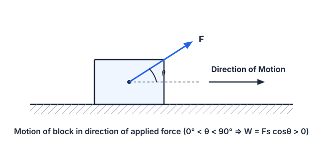
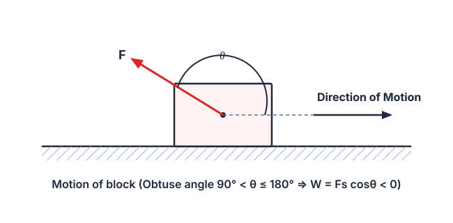
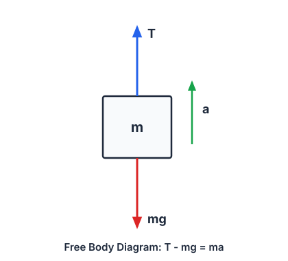
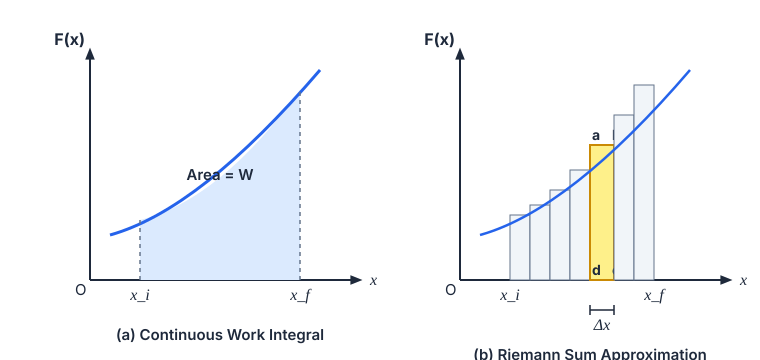
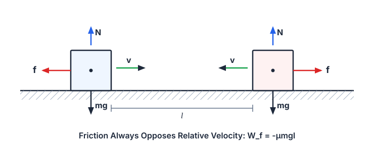
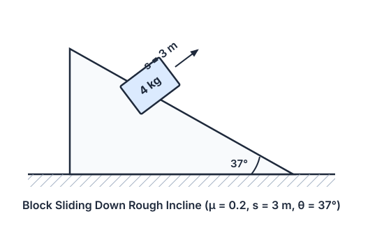
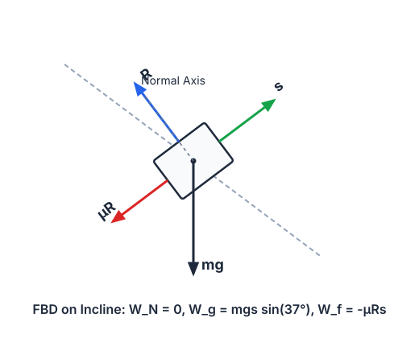
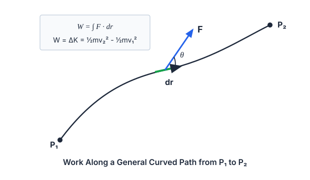
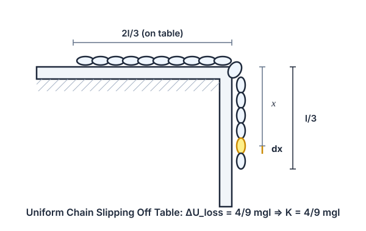
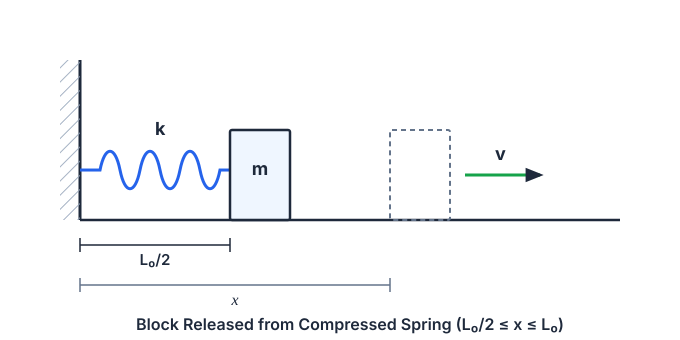

# 6. Work, Energy and Power & Collisions

> **Source Document**: `D:\CodeD\g9v3.5\work energy power.pdf`  
> **Extraction & Digitization**: Upstream Harvester Protocol (`olympiad-web-harvester`)  
> **Target Curriculum**: Grade 9 Physics Advanced / JEE Foundation & Olympiad  
> **Topic Adapter Reference**: [`Physics/adapter/TopicAdapters.v1.json#work-energy-power`](file:///C:/Users/reall/Documents/antigravity/kind-carson/Physics/adapter/TopicAdapters.v1.json)  
> **Visual Assets**: 10 Authentically Digitized WCAG-Compliant SVG Diagrams

---

## 1. Introduction

This chapter explains the concepts of work and energy and how these quantities are related to each other. The law of conservation of energy is an important tool in physics, for the analysis of motion of a system of particles or bodies, and in understanding various phenomena in nature. When the nature of forces involved in a process are not exactly known, or when we want to avoid complicated calculations, then the law of conservation of energy proves to be an indispensable tool in solving many problems.

The importance of energy cannot be explained in words. The progress of science and civilization is based on finding new ways to efficiently use the energy available in nature in various forms. Energy is required by a person to perform his/her daily activities, as well as to run our automobiles and machines. Depletion of natural energy resources is a major concern these days. The efficiency of energy utilization processes and quantity of energy sources harnessed by a country determines the pace of its economic development.

---

## 2. Work

### 2.1 Work

In physics, a force is said to do work only when it acts on a body, and if there is a consequential displacement of the point of application in the direction of the force.

For example, say if a constant force $\vec{F}$ displaces a body through displacement $\vec{s}$, then the work done, $W$, is given by:

$$W = F s \cos\theta = \vec{F} \cdot \vec{s}$$

where:
- $s$ is the magnitude of displacement,
- $\theta$ is the angle between force and displacement vectors.

The SI unit of work is **Joule** ($\text{J}$) or **Newton-metre** ($\text{N}\cdot\text{m}$).

### Sign Convention of Work

We now define the sign convention of work as follows:
- When $0^\circ \le \theta < 90^\circ$, then $W = F s \cos\theta$ is **positive**, i.e., when the force constantly supports the motion of a body, work done by that force is said to be positive.

- When $90^\circ < \theta \le 180^\circ$, then $W = F s \cos\theta$ is **negative**, i.e., in this case force is not truly supporting the motion of the body and hence the work done by that force is said to be negative.

---

### 2.2 Nature of Work

Work done is signified by the scalar product equation:

$$W = \vec{F} \cdot \vec{s}$$

Based on this equation, three possible situations are possible regarding the nature or sign of the work done as listed here under:

**(a) Positive Work**:  
The work done is said to be positive if the angle $\theta$ between the force and displacement vectors is an acute angle ($0^\circ \le \theta < 90^\circ$).  
*Example*: When a horse pulls a cart on a level road, the work done by the horse is positive.

**(b) Zero Work**:  
The work done is zero if the force and displacement vectors are perpendicular to each other ($\theta = 90^\circ \implies \cos 90^\circ = 0$), or if either the force or displacement is zero.  
*Example*: When a body is moved along a circular path by a string, the work done due to the tension in the string is zero.

**(c) Negative Work**:  
The work done is said to be negative if the angle $\theta$ between the force and displacement vectors is an obtuse angle ($90^\circ < \theta \le 180^\circ$).  
*Example*: When a body slides over a rough surface, the resultant work done due to the frictional force is negative (the angle between the friction force and the displacement is $180^\circ$).

> [!TIP]
> **Concepts Insight — Anurag Saraf (JEE 2011, AIR 226)**  
> Students should be able to deduce that by positive work, force is actually doing what it is meant for, i.e., force wants to move a body in certain direction and if it moves in that direction then it's positive work.

---

### Illustration 1 (JEE Main)

**Problem**:  
Assume that a body is displaced from $\vec{r}_A = (2\text{m}, 4\text{m}, -6\text{m})$ to $\vec{r}_B = (6\hat{i} - 4\hat{j} + 2\hat{k})\text{ m}$ under a constant force $\vec{F} = (2\hat{i} + 3\hat{j} - \hat{k})\text{ N}$. Calculate the total work done.

**Solution**:  
The work done by the constant force $\vec{F}$ during displacement $\vec{s}$ of a particle is the scalar product of force and displacement:

$$W = \vec{F} \cdot \vec{s}$$

The position vectors are:
$$\vec{r}_A = 2\hat{i} + 4\hat{j} - 6\hat{k}\text{ m}$$
$$\vec{r}_B = 6\hat{i} - 4\hat{j} + 2\hat{k}\text{ m}$$

The displacement vector $\vec{s}$ is:
$$\vec{s} = \vec{r}_B - \vec{r}_A = (6\hat{i} - 4\hat{j} + 2\hat{k}) - (2\hat{i} + 4\hat{j} - 6\hat{k}) = 4\hat{i} - 8\hat{j} + 8\hat{k}\text{ m}$$

Taking the scalar product:
$$W = \vec{F} \cdot \vec{s} = (2\hat{i} + 3\hat{j} - \hat{k}) \cdot (4\hat{i} - 8\hat{j} + 8\hat{k})$$
$$W = (2)(4) + (3)(-8) + (-1)(8) = 8 - 24 - 8 = -24\text{ J}$$

$$\mathbf{W = -24\text{ J}}$$

---

### Illustration 2 (JEE Advanced)

**Problem**:  
A block of total mass $5\text{ kg}$ is being raised vertically upwards with the help of a string attached to it and it rises with an acceleration of $2\text{ m/s}^2$. Find the work done due to the tension in the string if the block rises by $2.5\text{ m}$. Also, calculate the work done due to gravity and the net work done. ($g = 9.8\text{ m/s}^2$).

**Solution**:  
The tension in the string acts vertically upwards and the block is also moving vertically upwards, so the work done by the tension will be positive. The force of gravity acts vertically downwards, so the work done by gravity will be negative.

1. **Calculate the Tension $T$**:  
   From the free-body diagram:
   $$T - mg = ma \implies T = m(g + a)$$
   $$T = 5(9.8 + 2) = 5(11.8) = 59\text{ N}$$

2. **Work Done by Tension $W_T$**:  
   Since tension $\vec{T}$ and displacement $\vec{s}$ are both directed upwards ($\theta = 0^\circ$):
   $$W_T = T s = 59 \times 2.5 = 147.5\text{ J}$$

3. **Work Done by Gravity $W_g$**:  
   Since gravity acts downwards while displacement is upwards ($\theta = 180^\circ$):
   $$W_g = -m g s = -5 \times 9.8 \times 2.5 = -122.5\text{ J}$$

4. **Net Work Done $W_{\text{net}}$**:  
   $$W_{\text{net}} = W_T + W_g = 147.5 + (-122.5) = 25\text{ J}$$

> [!TIP]
> **Concepts Insight — Nivvedan (JEE 2009, AIR 113)**  
> Point of application of force also plays a major role.  
> Zero work is done by a force in the following cases:
> - If the point of application of force is not changed in space even though the body moves (e.g. static friction in rolling without slipping).
> - If the body doesn't move but the point of application of force moves.

---

## 3. Work Done by a Variable Force

When the force is an arbitrary function of position, we use principles of calculus to evaluate the work done by it.

Replacing the actual continuous variation of force by a series of small discrete displacements $\Delta x_n$:
$$\Delta W_n = F_n \Delta x_n$$

The total work done is approximately given by the Riemann summation:
$$W \approx \sum_{n} F_n \Delta x_n$$

In the limit $\Delta x \to 0$ (number of subdivisions $N \to \infty$):
$$W = \lim_{\Delta x \to 0} \sum F(x)\Delta x = \int_{x_i}^{x_f} F(x) dx$$

$$\mathbf{W = \int_{x_i}^{x_f} F(x) dx = \text{Area under the } F-x \text{ curve and the } x\text{-axis}}$$

---

### Illustration 3 (JEE Main)

**Problem**:  
A force $F = (10 + 0.50x)\text{ N}$ is observed to act on a particle in the $x$ direction, where $x$ is in meters. Find the actual work done by this force during a displacement from $x = 0$ to $x = 2.0\text{ m}$.

**Solution**:  
For an infinitesimal displacement $dx$:
$$dW = F dx = (10 + 0.50x) dx$$

Integrating over the displacement bounds from $x = 0$ to $x = 2.0\text{ m}$:
$$W = \int_{0}^{2.0} (10 + 0.50x) dx = \left[ 10x + 0.50 \frac{x^2}{2} \right]_{0}^{2.0}$$
$$W = \left[ 10(2.0) + 0.25(2.0)^2 \right] - [0] = 20 + 1.0 = 21\text{ J}$$

$$\mathbf{W = 21\text{ J}}$$

---

## 4. Conservative and Non-Conservative Forces

### Conservative Forces
A force is said to be **conservative** if:
1. The work done by it in moving a particle from one point to another depends **only on the initial and final positions**, and is independent of the path taken.
2. The work done by the force along any closed path is identically zero:
   $$\oint \vec{F} \cdot d\vec{r} = 0$$

*Examples*: Gravitational force, electrostatic force, elastic spring force. All central forces are conservative.

### Non-Conservative Forces
If the work done by a force in moving a body between two points depends on the specific path followed, the force is **non-conservative**.
- The work done along a closed path is non-zero: $\oint \vec{F} \cdot d\vec{r} \ne 0$.
- Energy is dissipated into non-recoverable thermal, acoustic, or internal forms.

*Examples*: Frictional force, viscous drag.

---

## 5. Work Done Against Friction

The frictional force always opposes relative sliding motion between contact surfaces. Therefore, the work done by kinetic friction is always **negative** (or zero in static contact), and energy is lost as heat and sound.

> [!TIP]
> **Concepts Insight — Nitin Chandrol (JEE 2012, AIR 134)**  
> The work done by kinetic friction is either negative or zero, but never positive.  
> 
> - **Along a horizontal surface of length $l$**:
>   $$W_f = -\mu m g l$$
> - **Along an inclined plane of length $l$ and angle $\theta$**:
>   $$W_f = -\mu m g l \cos\theta$$

---

### Illustration 4 (JEE Main)

**Problem**:  
A block of mass $4\text{ kg}$ slides down a plane inclined at $37^\circ$ with the horizontal. The length of the plane is $3\text{ m}$. The coefficient of sliding friction between the block and the plane is $\mu = 0.2$. Find:
1. The work done due to gravity,
2. The work done by the frictional force,
3. The work done by the normal reaction between the block and the plane.  
($g = 9.8\text{ m/s}^2, \sin 37^\circ = 0.6, \cos 37^\circ = 0.8$).

  
  

**Solution**:  
1. **Work Done by Normal Reaction ($W_N$)**:  
   The normal reaction $\vec{R}$ is perpendicular to the inclined plane ($\theta = 90^\circ$ relative to displacement $\vec{s}$):
   $$W_N = R s \cos 90^\circ = 0$$

2. **Work Done by Gravity ($W_g$)**:  
   The angle between the downward vertical gravity force ($mg$) and the displacement vector along the incline is $(90^\circ - 37^\circ)$:
   $$W_g = mg s \cos(90^\circ - 37^\circ) = mg s \sin 37^\circ$$
   $$W_g = 4 \times 9.8 \times 3 \times \frac{3}{5} = 70.56\text{ J}$$

3. **Work Done by Friction ($W_f$)**:  
   The normal reaction is $R = mg \cos 37^\circ$. The kinetic friction is $f_k = \mu R = \mu mg \cos 37^\circ$, acting opposite to displacement ($\theta = 180^\circ$):
   $$W_f = -(\mu R) s = -(\mu mg \cos 37^\circ) s$$
   $$W_f = -(0.2) \times (4 \times 9.8 \times 0.8) \times 3 = -18.816\text{ J}$$

$$\mathbf{W_N = 0\text{ J}, \quad W_g = 70.56\text{ J}, \quad W_f = -18.816\text{ J}}$$

---

## 6. Power

**Power** is defined as the time rate at which work is done.

- **Average Power**:
  $$P_{\text{avg}} = \frac{\Delta W}{\Delta t}$$

- **Instantaneous Power**:
  $$P = \lim_{\Delta t \to 0} \frac{\Delta W}{\Delta t} = \frac{dW}{dt}$$

Since $dW = \vec{F} \cdot d\vec{s}$:
$$P = \frac{\vec{F} \cdot d\vec{s}}{dt} = \vec{F} \cdot \vec{v}$$

- **SI Unit**: **Watt** ($\text{W}$) or **Joule/second** ($\text{J/s}$).  
- **Dimensions**: $[M L^2 T^{-3}]$. Power is a scalar quantity.

---

### Illustration 5 (JEE Advanced)

**Problem**:  
A block of mass $m$ slides down a fixed smooth inclined plane of inclination angle $\theta$ and length $l$. Calculate the magnitude of instantaneous power developed by the gravitational force when the block reaches the bottom.

**Solution**:  
The power delivered by gravity is $P = \vec{F}_g \cdot \vec{v}$.

When the block reaches the bottom, its speed is given by Torricelli's theorem:
$$v = \sqrt{2gh} = \sqrt{2gl\sin\theta}$$

The velocity vector $\vec{v}$ is directed along the incline, which makes an angle of $(90^\circ - \theta)$ with the downward vertical gravity force $m\vec{g}$.
$$P = mg v \cos(90^\circ - \theta) = mg v \sin\theta$$
$$P = mg \sin\theta \sqrt{2gl\sin\theta} = \sqrt{2m^2 g^3 l \sin^3\theta}$$

$$\mathbf{P = \sqrt{2m^2 g^3 l \sin^3\theta}}$$

---

### Illustration 6 (JEE Main)

**Problem**:  
A particle of mass $m$ is moving in a circular path of constant radius $r$ such that its centripetal acceleration $a_c$ varies with time $t$ as $a_c = k^2 r t^2$, where $k$ is a constant. The power delivered to the particle by the net force acting on it is:  
(A) $2\pi m k^2 r^2$  
(B) $m k^2 r^2 t$  
(C) $\frac{m k^4 r^2 t^5}{3}$  
(D) Zero  

**Solution: (B)**  
The net force acting on the particle can be decomposed into centripetal and tangential components:
$$\vec{F} = \vec{F}_c + \vec{F}_t$$

1. Since centripetal force is perpendicular to velocity ($\vec{F}_c \perp \vec{v}$), the power delivered by the centripetal force is zero:
   $$P_c = \vec{F}_c \cdot \vec{v} = 0$$

2. Tangential force is collinear with velocity, so:
   $$P = P_t = F_t v$$

From the given centripetal acceleration:
$$a_c = \frac{v^2}{r} = k^2 r t^2 \implies v = krt$$

Differentiating with respect to time to find tangential acceleration:
$$a_t = \frac{dv}{dt} = kr$$

The tangential force is:
$$F_t = m a_t = mkr$$

Therefore, the instantaneous power delivered is:
$$P = F_t v = (mkr)(krt) = m k^2 r^2 t$$

$$\mathbf{\text{Correct Option: (B) } m k^2 r^2 t}$$

---

## 7. Energy

Energy is defined as the capacity of a body to perform work. It is a scalar quantity sharing the same SI unit as work (**Joule**).

### 7.1 Potential Energy

#### 7.1.1 Concept
Potential energy ($U$) is the energy possessed by a body or system by virtue of its position, configuration, or spatial state. It is independent of the dynamic trajectory by which the system arrived at that state.

Potential energy is intrinsically a relative quantity and requires the choice of a reference zero level ($U = 0$).

#### 7.1.2 Definition
$$\Delta U = U_B - U_A = -W_{c}(A \to B) = -\int_{A}^{B} \vec{F}_c \cdot d\vec{r}$$

> [!IMPORTANT]
> Potential energy is defined **strictly for conservative forces**. It cannot be defined for non-conservative forces because their work depends on the path taken.

#### 7.1.3 Gravitational Potential Energy (GPE)
When lifting a body of mass $m$ vertically through height $h$:
$$W_{\text{ext}} = mgh, \quad W_{\text{gravity}} = -mgh$$
$$\Delta U = -W_{\text{gravity}} = mgh$$

- When the center of mass of a body is raised by height $h$, $\Delta \text{GPE} = +mgh$.
- When the center of mass of a body is lowered by distance $h$, $\Delta \text{GPE} = -mgh$.

#### 7.1.4 Elastic Potential Energy
Work performed against the internal restoring force of an elastic medium is stored as elastic potential energy.

#### 7.1.5 Nature of Restoring Force
When a spring is stretched or compressed by displacement $x$ from its natural length, it exerts a Hookean restoring force:
$$F_s = -kx$$

The work done by the spring force during displacement from $0$ to $x$ is:
$$W_s = \int_{0}^{x} (-kx')dx' = -\frac{1}{2}kx^2$$

The elastic potential energy stored in the spring is:
$$U = -W_s = \frac{1}{2}kx^2$$

---

## 9. Work-Energy Theorem

The work done on a particle by the net resultant force equals the change in its kinetic energy:

$$W_{\text{net}} = K_f - K_i = \Delta K \quad \text{--- (i)}$$

This theorem holds generally for both constant and variable forces, along arbitrary curved paths, in any inertial frame of reference.

### Partitioning Forces
Decomposing the total work into conservative ($W_c$), non-conservative ($W_{NC}$), and other external/pseudo forces ($W_{\text{oth}}$):

$$W_c + W_{NC} + W_{\text{oth}} = \Delta K \quad \text{--- (ii)}$$

Substituting $W_c = -\Delta U$:
$$-\Delta U + W_{NC} + W_{\text{oth}} = \Delta K$$
$$W_{NC} + W_{\text{oth}} = \Delta K + \Delta U = \Delta(K + U) \quad \text{--- (iii)}$$

Defining the total **Mechanical Energy** $E = K + U$:
$$\mathbf{W_{NC} + W_{\text{oth}} = \Delta E}$$

If only conservative forces perform work ($W_{NC} = 0, W_{\text{oth}} = 0$):
$$\Delta E = 0 \implies E = K + U = \text{constant (Conservation of Mechanical Energy)}$$

---

## 10. Kinetic Energy

### 3D Calculus Derivation

Consider a particle moving along an arbitrary curved trajectory from point $P_1$ to $P_2$ under the action of net force $\vec{F}$:
$$W = \int_{P_1}^{P_2} \vec{F} \cdot d\vec{r} = \int_{P_1}^{P_2} (F_x dx + F_y dy + F_z dz)$$

From Newton's second law along the $x$-direction:
$$F_x = m a_x = m \frac{dv_x}{dt}$$

Using the chain rule:
$$\frac{dv_x}{dt} = \frac{dv_x}{dx}\frac{dx}{dt} = v_x \frac{dv_x}{dx}$$

Substituting into the work integral:
$$\int_{P_1}^{P_2} F_x dx = \int_{P_1}^{P_2} m v_x \frac{dv_x}{dx} dx = \int_{v_{x1}}^{v_{x2}} m v_x dv_x = \frac{1}{2}m (v_{x2}^2 - v_{x1}^2)$$

Extending identically to $y$ and $z$ axes:
$$W = \frac{1}{2}m \left[ (v_{x2}^2 + v_{y2}^2 + v_{z2}^2) - (v_{x1}^2 + v_{y1}^2 + v_{z1}^2) \right] = \frac{1}{2}m (v_2^2 - v_1^2)$$

$$W = \frac{1}{2}mv_2^2 - \frac{1}{2}mv_1^2$$

Defining kinetic energy:
$$K = \frac{1}{2}mv^2$$

### Properties of Kinetic Energy
1. **Always Non-Negative**: Since mass $m > 0$ and $v^2 \ge 0$, kinetic energy is strictly positive or zero ($K \ge 0$), independent of the direction of motion.
2. **Relation to Linear Momentum ($p = mv$)**:
   $$K = \frac{p^2}{2m}$$
3. **Frame Dependence**: Kinetic energy depends on the inertial reference frame. For example, a passenger seated in a moving train has $K = 0$ in the train's frame, but $K = \frac{1}{2}mv^2$ relative to the ground.

---

## 11. Advanced Master Illustrations

### Illustration 11 (JEE Main): Overhanging Slipping Chain

**Problem**:  
A uniform flexible chain of length $l$ and mass $m$ overhangs a smooth horizontal table with two-thirds ($2l/3$) of its length lying on the table. Find the kinetic energy of the chain as it completely slips off the table.

**Solution**:  
Choose the table surface as the gravitational potential energy reference plane ($U_{\text{table}} = 0$).

1. **Initial Potential Energy ($U_1$)**:  
   The portion on the table ($2l/3$) has $U = 0$.  
   The hanging portion has length $l/3$. Consider an infinitesimal element of length $dx$ at depth $x$ below the table edge ($0 \le x \le l/3$):
   $$dm = \frac{m}{l}dx$$
   $$dU = - (dm) g x = -\frac{m}{l}g x dx$$
   $$U_1 = \int_{0}^{l/3} -\frac{m}{l}g x dx = -\frac{m g}{l} \left[ \frac{x^2}{2} \right]_{0}^{l/3} = -\frac{mg}{l}\left( \frac{l^2}{18} \right) = -\frac{1}{18}mgl$$

2. **Final Potential Energy ($U_2$)**:  
   When the entire chain has just slipped off the table, the chain hangs vertically between $x = 0$ and $x = l$:
   $$U_2 = \int_{0}^{l} -\frac{m}{l}g x dx = -\frac{mg}{l} \left[ \frac{l^2}{2} \right] = -\frac{1}{2}mgl$$

3. **Loss in Potential Energy = Gain in Kinetic Energy**:  
   Since the table is frictionless and no non-conservative forces act:
   $$\Delta K = -\Delta U = U_1 - U_2$$
   $$K_{\text{final}} - 0 = \left( -\frac{1}{18}mgl \right) - \left( -\frac{1}{2}mgl \right) = \left( \frac{1}{2} - \frac{1}{18} \right)mgl = \frac{8}{18}mgl = \frac{4}{9}mgl$$

$$\mathbf{K = \frac{4}{9}mgl}$$

---

### Illustration 12 (JEE Advanced): Spring-Block System Release

**Problem**:  
A block of mass $m$ is pushed against a light spring of spring constant $k$ fixed at one end to a rigid vertical wall. The block slides on a frictionless horizontal table. The natural length of the spring is $L_0$. The spring is compressed to half its natural length ($x_{\text{init}} = L_0/2$) and the block is released from rest. Find the velocity of the block as a function of its distance $x$ from the wall.

**Solution**:  
The system consists of the block and the spring. The surface is frictionless, so mechanical energy is conserved throughout the motion.

1. **Initial State ($x = L_0/2$)**:  
   The block is released from rest ($v = 0 \implies K = 0$).  
   The compression of the spring is:
   $$\Delta x_{\text{init}} = L_0 - \frac{L_0}{2} = \frac{L_0}{2}$$
   Total initial mechanical energy:
   $$E = \frac{1}{2}k (\Delta x_{\text{init}})^2 = \frac{1}{2}k \left(\frac{L_0}{2}\right)^2 = \frac{1}{8}k L_0^2$$

2. **Motion while in Contact with Spring ($\frac{L_0}{2} \le x \le L_0$)**:  
   At any position $x$, the compression of the spring is $(L_0 - x)$.  
   By conservation of mechanical energy:
   $$\frac{1}{2}mv^2 + \frac{1}{2}k(L_0 - x)^2 = \frac{1}{8}k L_0^2$$
   $$\frac{1}{2}mv^2 = \frac{1}{2}k \left[ \frac{L_0^2}{4} - (L_0 - x)^2 \right]$$
   $$v(x) = \sqrt{\frac{k}{m} \left[ \frac{L_0^2}{4} - (L_0 - x)^2 \right]}$$

3. **Motion after Losing Contact ($x > L_0$)**:  
   At $x = L_0$, the spring reaches its natural length and cannot pull on the detached block. The block loses contact with the spring and travels with constant maximum velocity:
   $$v_{\max} = \sqrt{\frac{k}{m}} \left(\frac{L_0}{2}\right)$$

$$\mathbf{v(x) = \begin{cases} \sqrt{\frac{k}{m}\left[\frac{L_0^2}{4} - (L_0 - x)^2\right]}, & \frac{L_0}{2} \le x \le L_0 \\[8pt] \frac{L_0}{2}\sqrt{\frac{k}{m}}, & x > L_0 \end{cases}}$$

---

## 12. Summary of Key Formulas

| Quantity / Principle | Mathematical Formulation | Notes |
|---|---|---|
| **Constant Force Work** | $W = \vec{F} \cdot \vec{s} = F s \cos\theta$ | Positive for $0^\circ \le \theta < 90^\circ$; zero for $\theta = 90^\circ$; negative for $90^\circ < \theta \le 180^\circ$ |
| **Variable Force Work** | $W = \int_{x_i}^{x_f} F(x) dx = \text{Area under } F-x \text{ curve}$ | Riemann integral in 1D |
| **Conservative Condition** | $\oint \vec{F} \cdot d\vec{r} = 0 \iff \vec{F} = -\nabla U$ | Path independent; potential energy exists |
| **Friction Work (Horizontal)** | $W_f = -\mu mgl$ | Always non-positive |
| **Friction Work (Incline)** | $W_f = -\mu mgl \cos\theta$ | $l$ is sliding distance along incline |
| **Instantaneous Power** | $P = \vec{F} \cdot \vec{v} = \frac{dW}{dt}$ | SI unit: Watt ($\text{W} = \text{J/s}$) |
| **Work-Energy Theorem** | $W_{\text{net}} = \Delta K = \frac{1}{2}mv_f^2 - \frac{1}{2}mv_i^2$ | General for all forces |
| **Mechanical Energy Theorem** | $W_{NC} + W_{\text{oth}} = \Delta(K + U) = \Delta E$ | $E = \text{const}$ when $W_{NC} = W_{\text{oth}} = 0$ |
| **Spring Potential Energy** | $U_s = \frac{1}{2}kx^2$ | $x$ is extension or compression from natural length |
